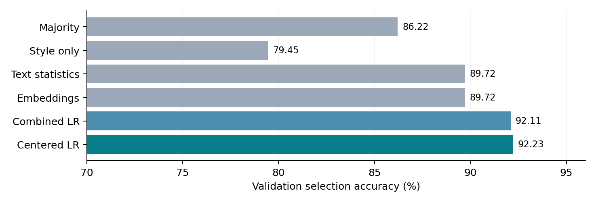
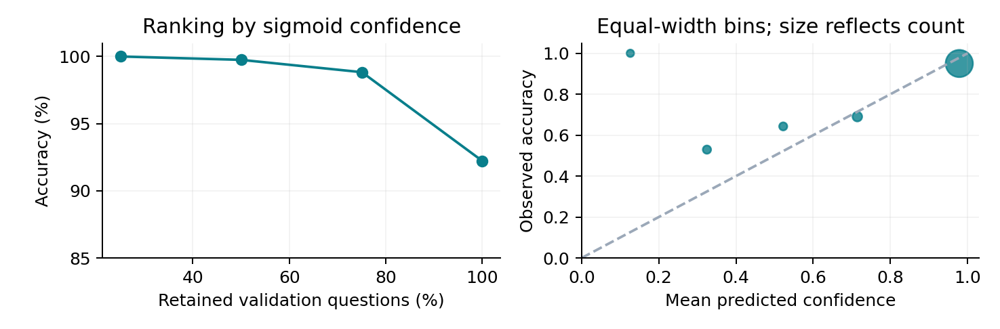

Selecting Reliable
LLM Reasoning

DASE7506 - Mini-project 2 | 31 October 2026

A compact verifier combining frozen representations, answer agreement and trace statistics

This project asks whether inexpensive candidate statistics complement supplied whole-trace representations, and whether nonlinear models justify their extra complexity. A standardized, regularized logistic verifier is selected using validation accuracy. It uses no external data, pretrained weights or inference-time generation.

| Frozen result | Evidence |

| --- | --- |

| Validation accuracy | 92.23% (736 / 798); majority voting: 86.22% |

| Official test accuracy | 81.37044968% (380 / 467) |

| Local test prediction + scoring | 0.925 s; four threads; fresh processes |

| Required inference assets | 26,397 bytes (0.025 MiB); limit: 16 MiB |

Task and evaluation target

For each question, choose one of four supplied candidate solutions. A correct final numeric answer receives one point, even when several candidates are correct. This is answer selection, not certification that every intermediate reasoning step is valid. The official numeric parser and evaluator are unchanged.

| Split | Questions | Role |

| --- | --- | --- |

| Train | 4,755 | Fit features, scaling and model weights |

| Validation | 798 | Select configurations and analyze behavior |

| Test | 467 | Score the frozen method only |

Main finding

Combining representations and simple statistics improves validation accuracy over either feature family alone. Increasing model complexity does not improve the selected score. However, performance drops on questions with multiple distinct answers; the overall validation score includes many easy consensus groups. The method is useful as a compact selector, but it does not reliably verify arithmetic or interpretation.

All recorded results are local measurements on the released course bank. The reference-machine time limit and performance on an instructor audit bank remain unverified.


---


1. Method and experimental protocol

Candidate features

| Feature family | Dimensions | Information used |

| --- | --- | --- |

| Frozen embedding | 1,024 | Supplied whole-trace representation; no extra encoder |

| Trace / answer statistics | 46 | Lengths; numeric and formatting counts; 19 lexical indicators; parsed answer properties; within-question agreement and relative statistics |

| Centered embedding | 1,024 | Candidate embedding minus the mean of the four embeddings |

| Final input | 2,094 | Embedding + centered embedding + 46 statistics |

The 46 statistics contain 11 surface / question-length features, six answer properties, 19 word-pattern counts and ten group-comparison features. They include answer validity, sign, integer status, log magnitude, answer frequency, distinct-answer count and relative length. No candidate index or question ID enters the model. Text statistics are not a semantic proof checker; the embedding carries the supplied representation of the reasoning.

Training and decision rule

Each candidate receives a binary label by comparing its parsed final answer with the training reference. All correct candidates are positive. StandardScaler is fit on the 19,020 training candidates only. A logistic model minimizes binary cross-entropy with L2 regularization; the selected inverse regularization strength is C = 0.01. Inference standardizes each feature vector and returns the largest logit among parseable candidates. If none parses, it returns the largest unmasked score. Ties use the first candidate.

```
x_ij = [embedding_ij, embedding_ij - mean_i, statistics_ij]
z_ij = w^T ((x_ij - training_mean) / training_scale) + b
choice_i = argmax_j z_ij     (invalid parsed answers masked)
```

**Centering has an important limitation.** In a linear scorer, the group-mean contribution is identical across a question and cancels when comparing candidates. The extra centered block changes the fitted binary objective and effective regularization; it does not create nonlinear cross-candidate reasoning at inference. The agreement statistics do provide direct comparative information.

Development search

The fixed search evaluates two C values for agreement, style and text statistics, and three for embeddings, combined and centered features: 15 logistic fits. Six 64-unit ReLU MLPs use seeds 2026/2027; three equal-logit ensembles and two text-only histogram boosting models are also compared. MLPs use alpha = 1, Adam, batch size 256, at most 100 epochs and internal training-only early stopping. Boosting is an analysis-only comparison. External validation determines the submitted portable model; the test does not influence selection.

The MLP internal split is candidate-level and may contain siblings of training candidates. It is not an independent question-level performance estimate; all reported model selection results use the separate question-disjoint validation split.


---


2. Accuracy, ablations and computational cost

| Validation method | Acc. % | Fit s | Eval. s | Asset KiB |

| --- | --- | --- | --- | --- |

| Agreement LR | 85.96 | 0.06 | 1.23 | 1.2 |

| Style LR | 79.45 | 0.02 | 1.22 | 1.2 |

| Statistics LR | 89.72 | 0.03 | 1.24 | 1.6 |

| Embedding LR | 89.72 | 2.25 | 0.46 | 13.1 |

| Combined LR | 92.11 | 2.32 | 1.23 | 13.6 |

| Centered LR (selected) | 92.23 | 2.44 | 1.25 | 25.6 |

| Combined MLP, seed 2026 | 91.98 | 2.61 | 1.24 | 277.9 |

| Centered MLP, seed 2027 | 91.60 | 2.72 | 1.27 | 541.9 |

| Combined MLP ensemble | 90.98 | 6.59 | 1.25 | 555.8 |

Eval. s includes two fresh official processes: prediction and scoring, startup, imports, data hashing/loading and preprocessing. Assets include each measured configuration; the submitted configuration adds descriptive metadata. Measurements are single local runs, with the OS disk cache unflushed. Fit s excludes shared feature construction.



Majority voting reaches 86.22%; first parseable reaches 81.70%, raw candidate zero 78.20%, and uniformly random selection has expected accuracy 75.69%. Statistics and embeddings each reach 89.72%; combining them reaches 92.11%. The selected centered variant reaches 92.23%, only one additional question, so its small advantage over combined LR should not be treated as a robust gain.

The style-only ablation is weak despite masking invalid answers, which argues against explaining the improvement using length and formatting alone. Nonlinear models and ensembles add assets and fitting cost without improving validation selection. Text-only boosting reaches 90.10% at best. All experiments, including lower-scoring configurations, are recorded in experiments.json.


---


3. Reliability, disagreement and split difficulty

| Distinct valid answers | Questions | Majority % | Selected model % |

| --- | --- | --- | --- |

| 1 | 443 | 100.00 | 100.00 |

| 2 | 227 | 77.09 | 87.67 |

| 3 | 108 | 60.19 | 73.15 |

| 4 | 20 | 25.00 | 75.00 |

The 443 validation questions with one distinct valid answer are solved by any rule that selects a parseable candidate. On the 355 informative validation questions with at least two distinct valid answers, accuracy is **82.54%**, versus **69.01%** for majority voting. The test bank deliberately contains multiple-answer groups, helping explain its lower 81.37% score. This subset comparison describes a distribution difference; it is not a matched or causal comparison between splits.

The selected model fixes 60 majority-vote mistakes and introduces 12, a net gain of 48 questions. When the methods select different numeric answers (82 questions), the model is correct on 60, or 73.17%. A paired question bootstrap with 5,000 resamples and seed 2026 gives a validation gain interval of +4.01 to +8.15 percentage points. This is descriptive: it does not account for selecting a model on the same validation bank.



Confidence is the sigmoid of the selected candidate logit, without post-hoc calibration. Retaining the highest-confidence half of validation gives 99.75% accuracy (398/399), but easy consensus questions inflate this figure. Within the informative subset, the top half reaches 95.51% (170/178). These are retrospective coverage diagnostics, not an abstaining submission or a guarantee on new data.

The five-bin ECE is 0.0379 and Brier score is 0.0633. The largest bin has mean confidence 0.9786 but accuracy 0.9501, showing overconfidence. Low-confidence bins have only 4, 17 and 14 examples and fluctuate sharply. Confidence is useful for ranking uncertainty here, but should not be interpreted as a well-calibrated probability of valid reasoning.

Every question must still receive a candidate choice. The evaluation method does not abstain, and no confidence threshold is chosen using test references.


---


4. Failure analysis and limits of verification

A fluent explanation can confuse people with pairs

Validation position 44 combines classes with 46 male and 48 female students. There can be 46 pairs, which use 92 students, leaving 2 unpaired. The selected candidate correctly totals the class sizes and finds 46 pairs, but subtracts 46 from 94 to return 48. It confuses a count of pairs with a count of people. Its orderly steps and correct intermediate sums do not make its final inference valid.

Correct arithmetic can still be applied to the wrong quantities

At validation position 48, Tom buys 20 shares for $3 each, sells 10 for $4 and values the remaining ten at $6. The reference profit is (40 + 60) - 60 = 40. The selected candidate instead takes the first sale profit of $10, multiplies it by ten again and returns 100, while ignoring the remaining position in its final profit calculation. The selector does not enforce consistent units or cash-flow accounting.

A local arithmetic slip survives a plausible strategy

At validation position 52, a dog closes a 0.6-mile gap at 24 - 15 = 9 mph. The selected candidate uses the correct relative-speed method but writes 0.6 / 9 = 2/15 hour, giving 8 minutes. The actual value is 1/15 hour, or 4 minutes. A compact learned verifier can recognize a plausible strategy without detecting its arithmetic error.

Reference agreement and interpretation can diverge

At validation position 32, Yun has 8 paperclips. The question says Marion has "1/4 more than what Yun currently has, plus 7." The selected answer is 8 + 2 + 7 = 17, consistent with one ordinary reading of "1/4 more." The supplied reference instead computes 8/4 + 7 = 9. The scorer therefore marks 17 wrong. This example is a possible wording/reference ambiguity, not evidence that all benchmark errors are reasoning failures. The parser and reference were kept unchanged.

What the experiment does and does not establish

The evidence supports complementary predictive information in frozen embeddings and inexpensive statistics. It does not establish step-by-step mathematical verification, generalization to a different generator, or causal use of reasoning semantics. The small centered-versus-combined difference, validation search, candidate-level internal MLP split, small hard subgroups and single-machine resource measurements limit stronger conclusions. There is no separate untouched development bank for uncertainty estimates.

The 62 validation errors, full candidate texts and per-question confidence values are provided in validation_errors.json and validation_choices.csv so that the qualitative analysis can be checked. Future work could add explicit arithmetic or unit-consistency features, but no such change was made after freezing or inspecting the final test score.


---


5. Reproduction, resources and disclosure

Frozen artifact and evaluation

The frozen model is **lr_context_0.01**. The official test result is **380/467 = 81.37044968%**. The matching assets are code/runs/model_bundle/config.json and lr_context_0.01.npz. runs/freeze.json records SHA-256 hashes and the freeze timestamp, before final test evaluation. Inference needs NumPy only and receives new bank inputs through the official interface; it never opens reference files.

Local hardware: Intel Core i7-13650HX (14 cores / 20 logical processors), Windows 11, Python 3.12.7. Evaluation limits NumPy/BLAS/OpenMP to four threads. Validation prediction plus scoring took 1.275 s; test took 0.925 s. Inference assets total 26,397 bytes, including the uncompressed NPZ container and JSON configuration. All fitted arrays and statistics are included. The full development search took 71.97 s locally, including preprocessing. No GPU was used. Reference Xeon runtime was not measured.

Exact commands from code/ (Python 3.12)

```
python -m pip install -r requirements.txt
python check_data.py
python evaluate.py --split validation
python evaluate.py --split test

# Optional retraining in a separate directory; do not overwrite frozen assets
python -m pip install -r requirements-training.txt
python train.py --output runs/retrained
```

evaluate.py sets all relevant thread environment variables before launching fresh official prediction and scoring processes. The README also lists the direct official commands. Training pins NumPy 1.26.4, SciPy 1.13.1, scikit-learn 1.5.1, joblib 1.4.2 and threadpoolctl 3.5.0. Runs use seeds 2026/2027. Learned scaling is training-only. No train/validation refitting or test-based tuning was performed. The data checker passed all hashes and alignment checks; inference was checked on renamed IDs, a seven-question subset and permuted candidates.

AI assistance and reused material

OpenAI Codex provided substantive assistance with feature/model design, implementation, debugging, local experiment execution, analysis and report drafting. This assistance extends beyond code completion. The included experiment files are actual recorded outputs. The submitter should review and understand the implementation and analysis before submission. Official loader, numeric parser, runner and independent scorer are reused unchanged; no other external solution code, datasets or pretrained weights are used.

Sources and attribution

[1] DASE7506-MP2 Project Guide and running instructions, upstream commit bb801f4f2e7629d270df765ab12c333b2dc616bb.
github.com/xudongwu-0/DASE7506-MP2
[2] GSM8K: github.com/openai/grade-school-math (MIT; supplied license retained).
[3] Supplied representations/candidates: Qwen3-0.6B; source revision recorded in code/data/manifest.json.
[4] scikit-learn implementations of LogisticRegression, MLPClassifier and HistGradientBoostingClassifier, version 1.5.1.

The result and files are ready for repository publication. Creating the required GitHub submission issue is a separate final action; this report does not claim that submission has occurred.
